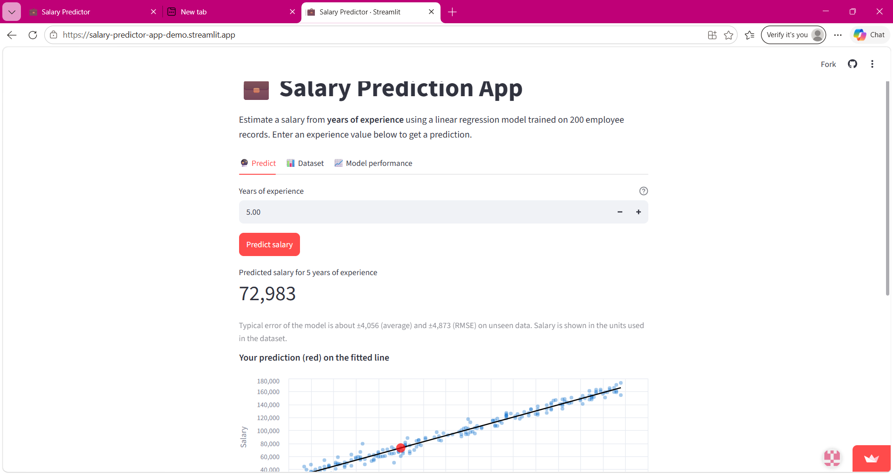
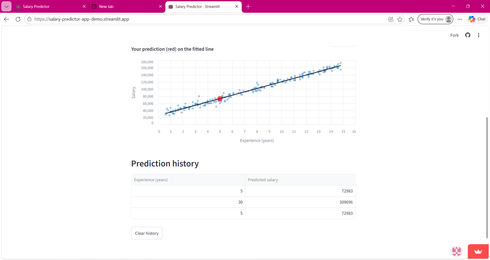
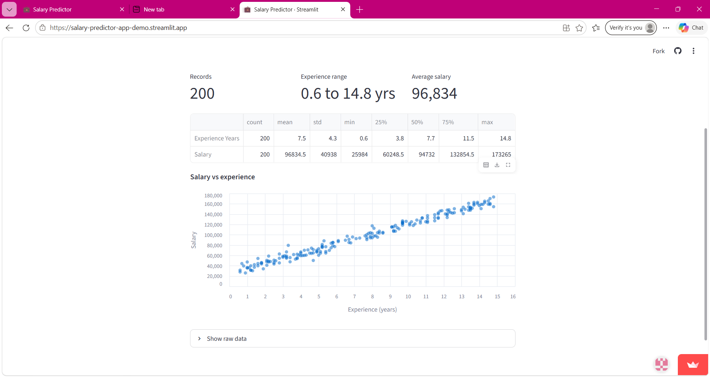
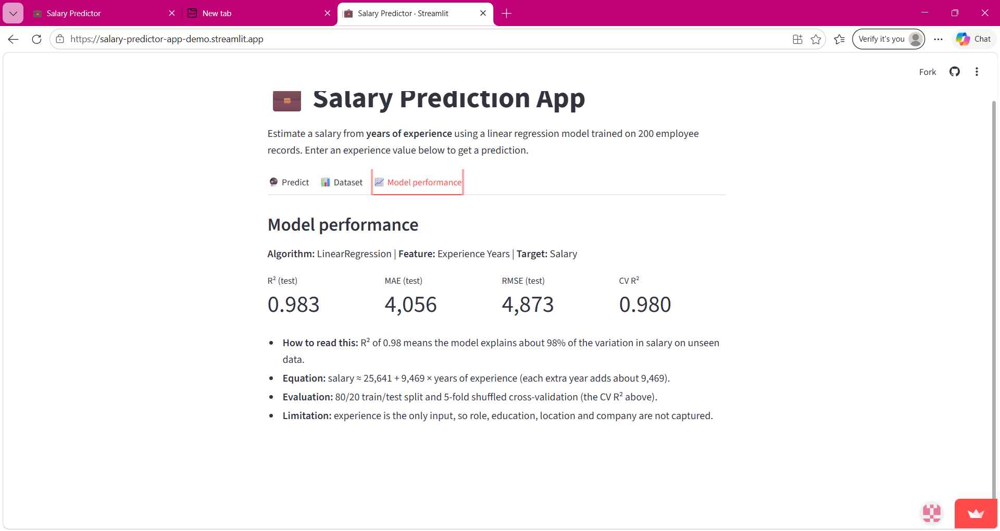

# Salary Prediction App

An end-to-end machine learning project that predicts **salary from years of experience** using a regression model, deployed through an interactive **Streamlit** web application.

**Live Demo:** [Salary Prediction App](https://salary-predictor-app-demo.streamlit.app)

## App Screenshots

### Salary Prediction


### Prediction History


### Dataset


### Model Performance


---

## Project Description

The app allows users to enter their years of experience and receive a predicted salary. It also provides:

- A preview of the dataset.
- Model performance metrics.
- A visualization of the prediction on the fitted regression line.
- A history of predictions made during the current session.

The model is trained separately in a Jupyter Notebook and saved using `joblib`. The Streamlit application loads the saved model rather than retraining it every time the app runs.

## Dataset

- **File:** `data/salary_dataset.csv`
- **Size:** 200 records and 2 columns.
- **Features:** `Experience Years` and `Salary`.
- **Source:** Salary dataset provided in class (GitHub).
- **Data quality:** No missing values or duplicate records.
- **Currency:** The dataset does not specify a salary currency, so values are displayed in the dataset's original units.

## Model

- **Algorithm:** Linear Regression using scikit-learn.
- **Feature:** `Experience Years`
- **Target:** `Salary`
- **Model selection:** Polynomial regression models of degrees 2 and 3 were compared but did not provide meaningful improvement. Therefore, the simpler and more interpretable linear regression model was selected.
- **Validation:** An 80/20 train-test split using `random_state=42`, along with shuffled 5-fold cross-validation.
- **Final model:** Refit on all 200 records and saved to `model/model.pkl`.

Shuffling is used during cross-validation because the dataset is sorted by experience. Without shuffling, the folds could produce misleading evaluation results.

## Evaluation Metrics

| Metric | Value |
|---|---:|
| Test-set R² | 0.983 |
| Test-set MAE | 4,056 |
| Test-set RMSE | 4,873 |
| 5-fold shuffled CV R² (mean ± SD) | 0.980 ± 0.005 |

**Fitted regression equation:**

```text
salary ≈ 25,641 + 9,469 × years of experience
```

### Limitations

- The model uses years of experience as its only input feature.
- Predictions are most reliable within the training data's experience range of **0.6 to 14.8 years**.
- Predictions outside this range involve extrapolation, so the app warns users when their input falls outside the training range.
- Salary currency is unspecified in the dataset.

## Project Structure

```text
ML_Project/
├── data/
│   └── salary_dataset.csv
├── model/
│   ├── model.pkl
│   └── metrics.json
├── notebooks/
│   └── model_training.ipynb
├── screenshots/
│   ├── app-prediction.png
│   ├── app-prediction-history.png
│   ├── app-dataset.png
│   └── app-model-performance.png
├── app.py
├── requirements.txt
├── README.md
└── .gitignore
```

## Run Locally

**Requirements:** Python 3.11 or newer.

### 1. Clone the repository

```bash
git clone https://github.com/naimasiddiqui10/salary-prediction-app.git
cd salary-prediction-app
```

### 2. Create and activate a virtual environment

**Windows:**

```bash
python -m venv venv
venv\Scripts\activate
```

**macOS/Linux:**

```bash
python3 -m venv venv
source venv/bin/activate
```

### 3. Install dependencies

```bash
pip install -r requirements.txt
```

### 4. Launch the application

```bash
streamlit run app.py
```

The application will open in your browser.

## Retrain the Model

To retrain the model, install Jupyter Notebook if it is not already installed:

```bash
pip install notebook
```

Open `notebooks/model_training.ipynb` and run all cells. This updates `model/model.pkl` and `model/metrics.json`.

## Tech Stack

- **Language:** Python
- **Data processing:** pandas, NumPy
- **Machine learning:** scikit-learn
- **Model serialization:** joblib
- **Web application:** Streamlit
- **Visualization:** Altair, Matplotlib, Seaborn
